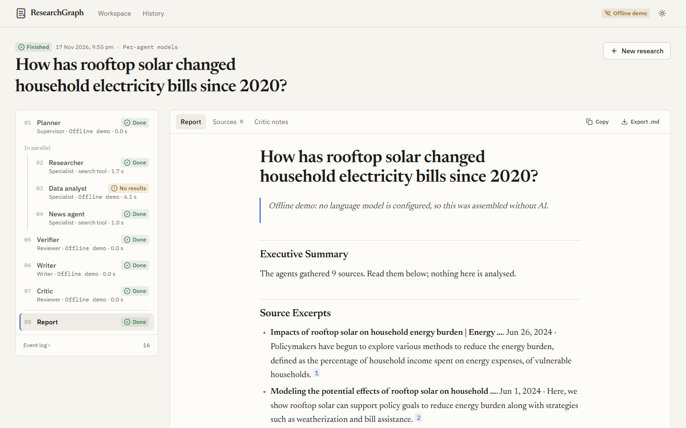
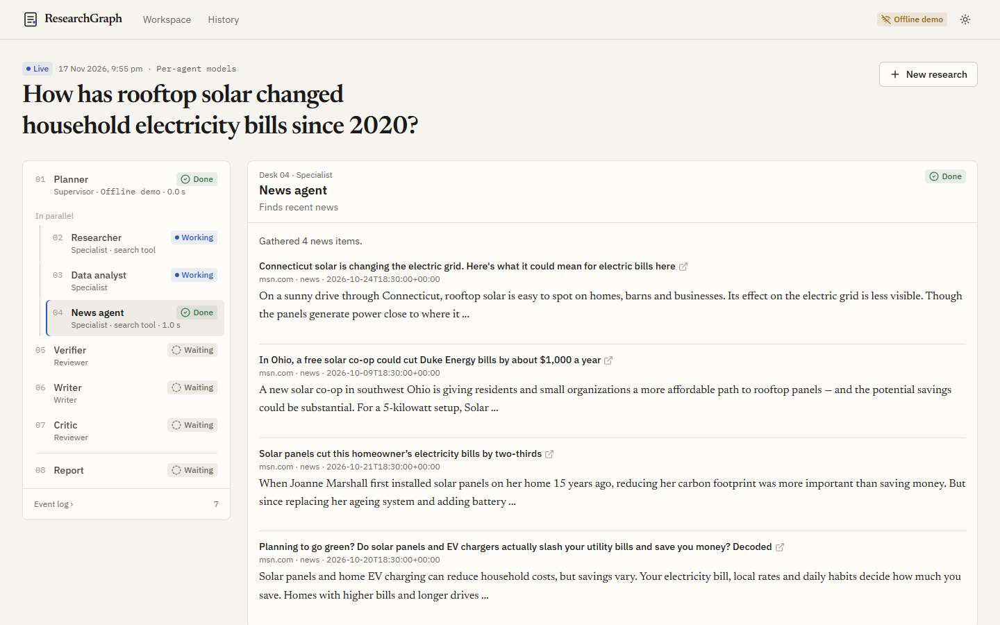
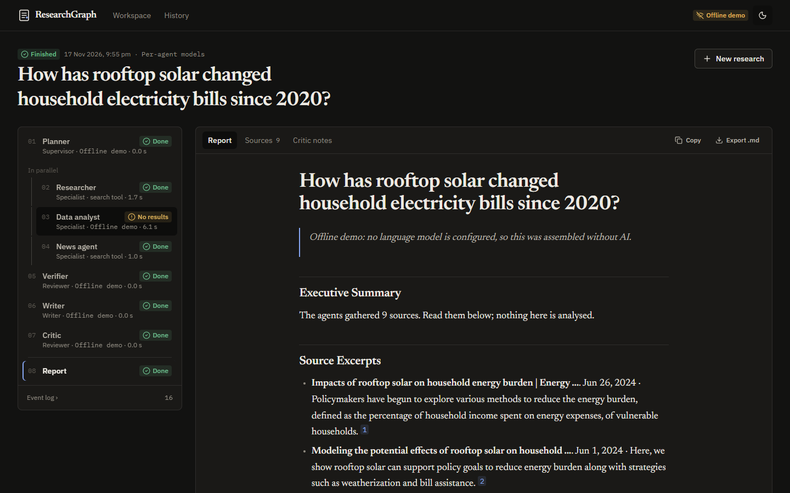
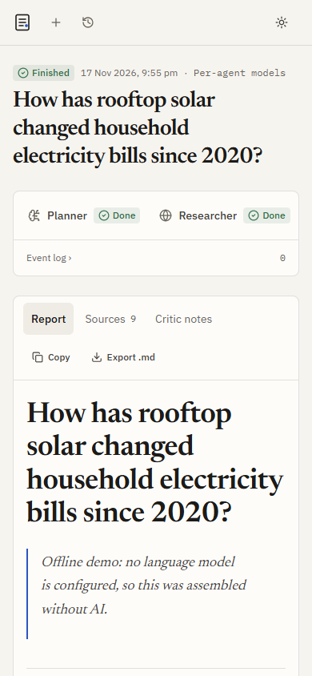

# ResearchGraph: a multi-agent research desk

Ask one research question. Seven AI agents plan the work, search the web and the news, pull out figures, check the claims and write a **cited** Markdown brief. You watch every step live, read the report with clickable citations, and keep asking follow-up questions (or ask the assistant to rewrite parts of the report).

**Live app:** <https://mutli-agent-orchestration.vercel.app/> (backend on Render, data on Neon PostgreSQL)



| Live run | Dark theme | Mobile |
|---|---|---|
|  |  |  |

## Features

- **Seven-agent pipeline (LangGraph):**
  - planner;
  - researcher, data analyst and news agent **in parallel**;
  - verifier;
  - writer;
  - critic, who can send the draft back for a rewrite.
- **Sources you can check:** the verifier and writer work from numbered real sources, the report cites them as `[n]`, and each citation opens that source. Nothing is invented: when search finds nothing, the report says so.
- **Two model modes with a 4-tier fallback:**
  - *Per-agent:* each kind of agent has its own model (supervisor, specialists, reviewers, writers).
  - *One model for all agents:* you pick it from a list.
  - Either way, a failed or empty answer falls through `primary → secondary → third → openrouter/free`, and rate limits and the daily free-tier limit are reported plainly.
- **Live progress that survives refreshes:** every run has a URL (`/runs/:id`). Progress streams over SSE; a reconnecting or late client gets the full history replayed, and polling takes over if the stream drops.
- **Routing slip:** one row per agent with status, the model that answered (flagged when a fallback tier did), timing, and a mark when the critic returned the draft. Click a row to see exactly what that agent produced.
- **Report chat:** ask follow-up questions grounded in the report and its sources, or ask for edits. Every edit can be **undone**.
- **History:** search, load more, open any past run, delete runs.
- **Light and dark themes**, responsive from phone to desktop, keyboard and screen-reader friendly.
- **Abuse protection** for public deployments: per-IP rate limits, a cap on concurrent runs, length limits, a model allowlist (no paid models on your key), and CORS from env.
- **Offline demo mode:** with no API key the whole app still runs. Reports are assembled from real search results and clearly labelled as not AI-analysed.

## How it works

```text
React (Vite) ──POST /api/research──► FastAPI ──background task──► LangGraph
     ▲                                  │                         planner
     │  SSE /api/research/{id}/stream   │                            │
     └──────── replay + live events ◄───┤        researcher ∥ data analyst ∥ news agent
                                        │                            │
     GET /api/research/{id}  ◄── SQL ───┤                         verifier
     (plan, logs, sources, report)      │                            │
                                        │                     writer ⇄ critic
                                        ▼
                         Neon PostgreSQL / SQLite (runs, plans, agent logs,
                         sources, reports, report versions, chat)
```

Every model call goes through one gateway (`backend/app/agent/llm.py`), which picks the agent's chain and walks it until a model answers.

| Kind | Agents | Default primary (env var) |
|---|---|---|
| Supervisor | planner | `PLANNER_MODEL` = nemotron-3-ultra-550b |
| Specialists | data analyst *(researcher and news agent only run searches)* | `SPECIALIST_MODEL` = nemotron-3.5-lightning |
| Reviewers | verifier, critic | `REVIEWER_MODEL` = gemma-4-31b-it |
| Writers | writer, report chat | `WRITER_MODEL` = nemotron-3.5-super-vl |

Shared fallbacks: `SECONDARY_MODEL` → `THIRD_MODEL` → `FALLBACK_MODEL` (`openrouter/free`). All are free OpenRouter models, configurable in `.env`.

## Tech stack

| Layer | Tech |
|---|---|
| Agents | LangGraph 1.2, langchain-core, langchain-openai (`ChatOpenAI` → OpenRouter) |
| Search | DuckDuckGo via `ddgs`, optional Tavily |
| API | FastAPI, sse-starlette, Uvicorn, Python 3.11, uv |
| Data | SQLAlchemy 2 (async), asyncpg (Neon PostgreSQL) or aiosqlite (local) |
| Web | React 19, Vite 8, Tailwind CSS 4, React Router 7, react-markdown, lucide-react |
| Quality | pytest, ruff, pyright · Vitest, Testing Library, Playwright, oxlint, Prettier |
| Deploy | Render (backend, `render.yaml`), Vercel (frontend, `frontend/vercel.json`) |

## Getting started

**You need:** Python 3.11 with [uv](https://docs.astral.sh/uv/), and Node 20+. An [OpenRouter key](https://openrouter.ai/keys) is optional (free tier; without one the app runs in offline demo mode).

### Backend

```bash
cd backend
cp .env.example .env          # then fill in OPENROUTER_API_KEY (and DATABASE_URL for Neon)
uv sync                       # creates .venv with app + dev tools
uv run uvicorn app.main:app --reload --port 8000
```

No `uv`? Use `python -m venv .venv` and `pip install -r requirements.txt`, then run `uvicorn app.main:app --reload --port 8000`.

Every setting is documented in [`backend/.env.example`](backend/.env.example): models, search, rate limits, CORS. With no `.env` at all you get SQLite and offline demo mode.

### Frontend

```bash
cd frontend
npm install
npm run dev                   # http://localhost:5173, proxies /api to :8000
```

For a deployed frontend, set `VITE_API_BASE_URL` to the backend URL (see [`frontend/.env.example`](frontend/.env.example)).

## Using it

1. On **Workspace**, type a question (or pick an example), choose **Per-agent** or **One model for all**, and press **Start research** (or Ctrl/Cmd+Enter). *Model map* shows which model each kind of agent will use.
2. The run page shows the routing slip live. Click any agent to see its output: the plan and search queries, sources found, figures with their source, the claims matrix, the draft, or the critic's decision.
3. When the critic approves, the report opens. Click a citation chip to jump to its source. **Copy** or **Export .md** as needed.
4. Ask follow-up questions below the report. Ask for an edit ("add a risks section") and the report is rewritten; **Undo last edit** restores the previous version.
5. **History** lists every run, with search, load more and delete.

## Project structure

```text
backend/
  app/
    agent/      graph.py (pipeline), nodes.py (7 agents), llm.py (model gateway),
                tools.py (search), prompts.py, offline.py (demo replies), state.py
    api/        routes_research.py, routes_history.py, routes_meta.py (health, models),
                deps.py (rate limits), serializers.py
    db/         database.py (engine, URL handling), models.py
    services/   research_service.py (runs the graph, persists, streams), chat_service.py,
                sse_manager.py (pub/sub with replay)
    config.py, main.py
  tests/        pytest suite (offline: fake LLM and search, temp SQLite)
frontend/
  src/
    pages/      WorkspacePage, RunPage, HistoryPage
    components/ RoutingSlip, AgentOutput, ReportViewer, ReportChat, Composer, ModelPicker,
                AppHeader, Markdown, RunList, ui/ (Button, Badge, Panel, Tabs, Select, …)
    hooks/      useRun (live run state), useModelSettings, useTheme
    lib/        api.js, agents.js, format.js
    styles/     index.css (design tokens, light/dark, report typography)
  e2e/          Playwright journey tests
docs/           ANALYSIS, PLAN, TEST_REPORT, CHANGELOG, screenshots, archive/
.interface-design/system.md   design system notes
```

## Testing

```bash
# backend
cd backend
uv run ruff check app tests && uv run ruff format --check app tests && uv run pyright
uv run pytest --cov                     # 102 tests, ~95 % coverage

# frontend
cd frontend
npm run lint && npx prettier --check .
npm test                                # Vitest, 41 tests (npm run test:coverage for numbers)
npm run test:e2e                        # Playwright: starts its own offline backend + Vite
npm run build
```

No test calls a real model or touches your database. The e2e suite uses the installed Microsoft Edge (`channel: 'msedge'`); on other machines change the channel or run `npx playwright install chromium`. See [docs/TEST_REPORT.md](docs/TEST_REPORT.md).

## Deploying

- **Backend (Render):** `render.yaml` builds from `backend/requirements.txt` and starts uvicorn with `--proxy-headers`, so rate limits see real client IPs. Its health check is `/health`. Set `OPENROUTER_API_KEY`, `DATABASE_URL` (Neon) and `CORS_ORIGINS` (your frontend URL), plus optionally `TAVILY_API_KEY`.
- **Frontend (Vercel):** root `frontend`, build `npm run build`, output `dist`, env `VITE_API_BASE_URL`.
- **Database:** tables are created on startup. Upgrading an existing Neon database only *adds* the `report_versions` table; existing tables are untouched.

## Future work

- Cancel a running research run (agents can only stop between steps today).
- Print / save the report as PDF.
- Move rate limits and SSE replay to Redis to run more than one backend instance.
- Persist per-run token usage and show cost/latency per agent.
- Server-side history search.

## License

MIT
